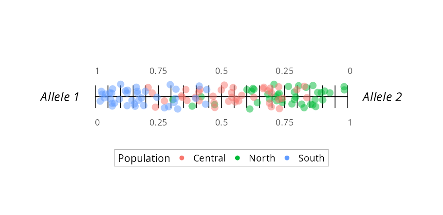
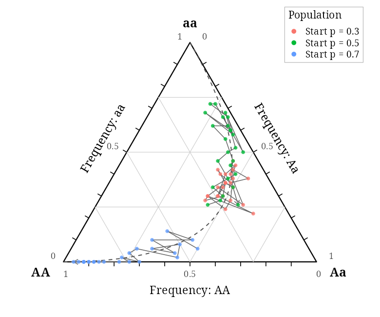
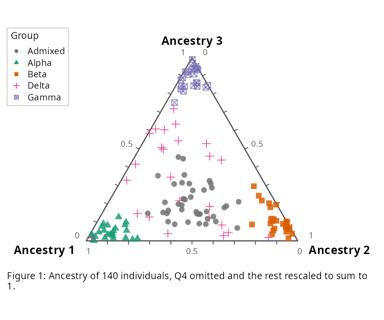
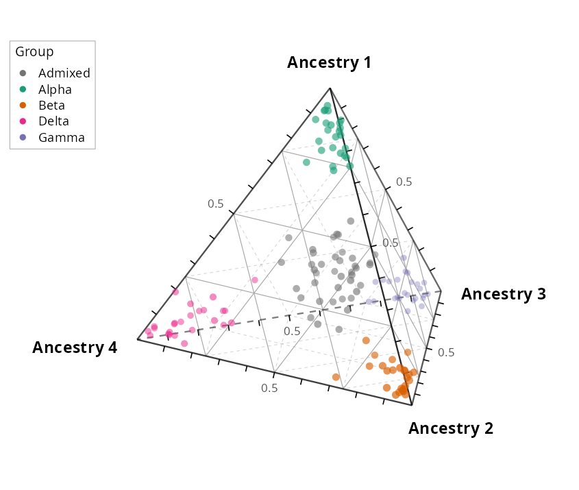
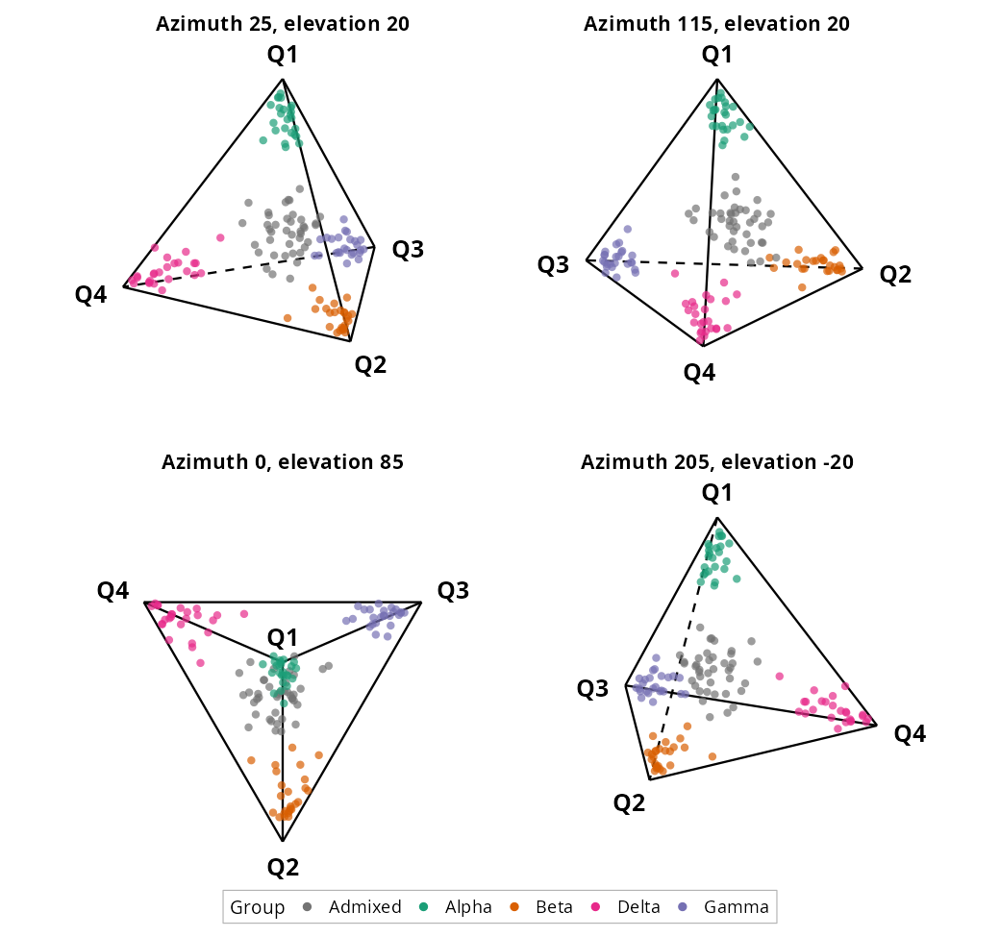
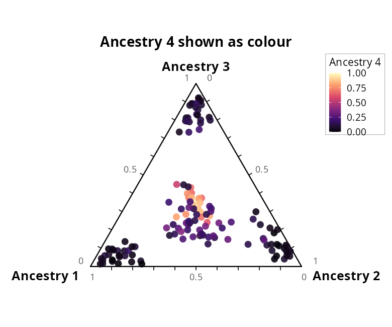

# definetti

ggplot2 routines for **de Finetti (simplex) plots** of allele frequencies, genotype
frequencies or the ancestry composition of individuals. A composition of K components
summing to 1 is drawn one dimension lower than K:

| K | drawn as |
|--:|----------|
| 2 | line segment |
| 3 | triangle |
| 4 | tetrahedron, projected (several views can be faceted), or a triangle with the 4th component as colour |

## Install

```r
# from a local clone
install.packages("path/to/definetti", repos = NULL, type = "source")
# or from GitHub:
remotes::install_github("mikegilchrist/definetti")
```

## Use

```r
library(definetti)
ext <- function(f) system.file("extdata", f, package = "definetti")
q4 <- read.csv(ext("individuals.ancestry_k4.csv"))
definetti_plot(q4, paste0("Q", 1:4), colour_by = "group")
```

Each figure below uses different options (the code is in `data-raw/readme.figures.R`).

**K = 2, line.** Finer ticks (`n_ticks = 20`), labels every 0.25 (`label_at`), larger translucent
points, italic corner labels (`vertex_label_face`), more vertical jitter (`jitter_height`).



**K = 3, triangle: trajectories and Hardy-Weinberg curve.** `connect_by` joins generations,
`show_hw = TRUE` draws the Hardy-Weinberg curve, gridlines at quarters (`grid_at`), serif font
(`base_family`), per-edge `axis_titles`.



**K = 3, triangle: individuals.** `colour_by` and `shape_by` together, own `palette`, no grid
(`show_grid = FALSE`), grey frame, bottom caption with `figure_number`, legend inset upper-left.



**K = 4, tetrahedron with gridlines on its faces.** `face_grid = TRUE` with `grid_at` at 0.25, 0.5
and 0.75 draws lines of constant frequency on each face; faces turned away from the viewer are
dashed and faint. Edge ticks are labelled at 0.5, and far points fade (`depth_cue`).



**K = 4, several views.** `view` takes a list of (azimuth, elevation) pairs, here without depth
cues or edge ticks and with larger corner labels and the legend at the bottom.



**K = 4, fourth component as colour.** `colour_component = "Q4"` shows the tetrahedron seen
down the Ancestry 4 corner as a triangle, with Ancestry 4 as a perceptually uniform colour scale
(`colour_option = "magma"`); `colour_range = c(low, high)` gives a CIELAB ramp instead.



Fonts, titles, labels, legend placement and line styles are plain arguments built on
`theme_definetti()`; the result is an ordinary ggplot. See `vignette("definetti")` and
`?definetti_plot` for all arguments.

Colour scales follow human perception: viridis-family palettes (`colour_option`) are
uniform in CIELAB lightness, and a custom `colour_range` is interpolated in CIELAB,
not RGB.

Example data are simulated (`data-raw/make.data.R`, fixed seed).

License: GPL (>= 3).
