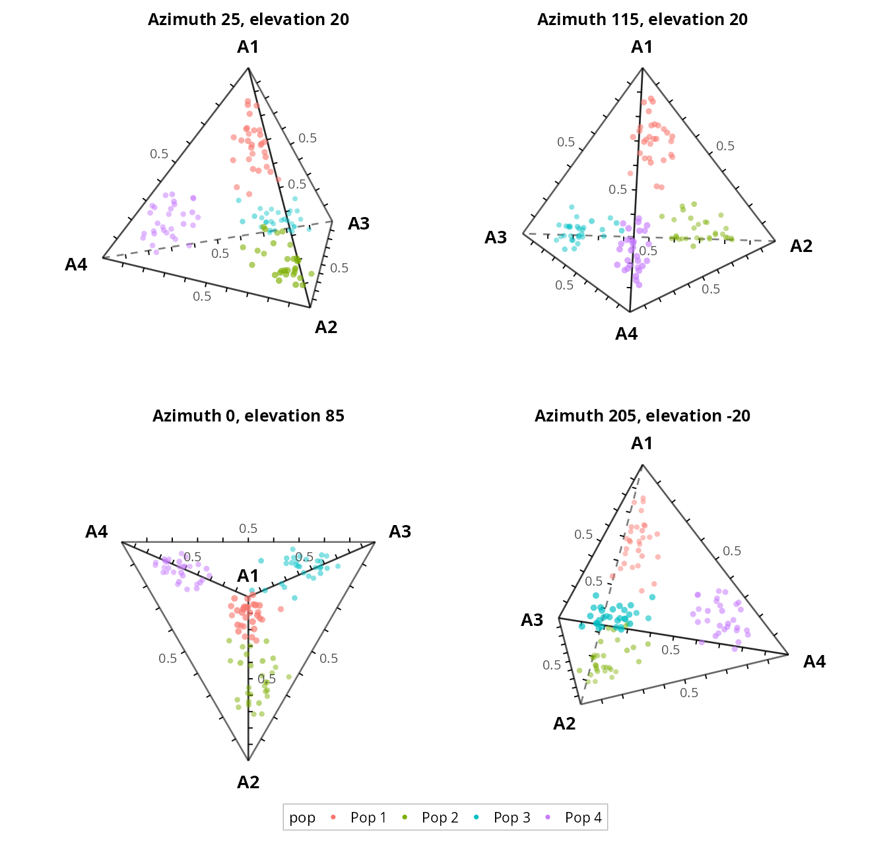

# definetti

ggplot2 routines for **de Finetti (simplex) plots** of allele frequencies, genotype
frequencies or the ancestry composition of individuals. A composition of K components
summing to 1 is drawn one dimension lower than K:

| K | drawn as |
|--:|----------|
| 2 | line segment |
| 3 | triangle |
| 4 | tetrahedron, projected (several views can be faceted), or a triangle with the 4th component as colour |

## Install

```r
# from a local clone
install.packages("path/to/definetti", repos = NULL, type = "source")
# or from GitHub:
remotes::install_github("mikegilchrist/definetti")
```

## Use

```r
library(definetti)
q <- read.csv(system.file("extdata", "individuals.ancestry_k4.csv", package = "definetti"))
definetti_plot(q, paste0("Q", 1:4), colour_by = "group", view = c(25, 20))
definetti_plot(q, paste0("Q", 1:4), colour_component = "Q4")   # perceptual colour scale
```



Fonts, titles, labels, legend placement and line styles are plain arguments built on
`theme_definetti()`; the result is an ordinary ggplot. See `vignette("definetti")` and
`?definetti_plot` for all arguments.

Colour scales follow human perception: viridis-family palettes (`colour_option`) are
uniform in CIELAB lightness, and a custom `colour_range` is interpolated in CIELAB,
not RGB.

Example data are simulated (`data-raw/make.data.R`, fixed seed).

License: GPL (>= 3).
